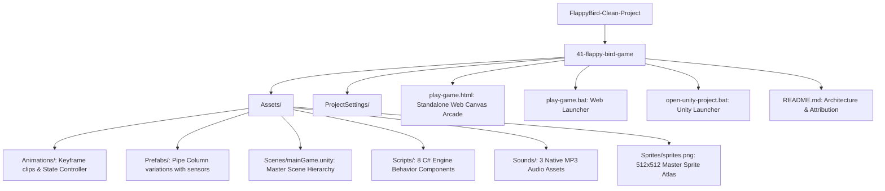

# Project Map & Technical Topology



---

## 1. Complete Folder Hierarchy & Artifact Purpose

```
c:\Users\lokesh lohiya\OneDrive\Desktop\Arnav code\new project\FlappyBird-Clean-Project\
└── 41-flappy-bird-game/
    ├── .git/                               # Local git version control repository metadata
    ├── .gitattributes                      # Git LFS and text file normalization configurations
    ├── .gitignore                          # Unity and OS-specific ignored file patterns
    ├── Assets/                             # Primary engine asset root directory
    │   ├── Animations/                     # Animation controllers and keyframe asset files
    │   │   ├── flappyAnimation.anim        # 3-frame wing flapping keyframe animation clip
    │   │   └── sprites_58.controller       # Animator state machine controlling flight states
    │   ├── Prefabs/                        # Reusable pre-configured GameObject templates
    │   │   ├── PipeColumnPrefab.prefab     # Standard obstacle prefab (Top/Bottom pipes + trigger)
    │   │   └── PipeColumnPrefab2.prefab    # Alternate pipe obstacle variation
    │   ├── Scenes/                         # Engine scene hierarchy definitions
    │   │   └── mainGame.unity              # Master game scene containing camera, player, UI, lights
    │   ├── Scripts/                        # Core C# gameplay logic and system components
    │   │   ├── CameraFollow.cs             # Smooth horizontal camera positioning component
    │   │   ├── FlappyScript.cs             # Player kinematics, input, rotation, and life cycle
    │   │   ├── FloorMoveScript.cs          # Infinite horizontal scrolling floor controller
    │   │   ├── GameState.cs                # Global enum and static state manager container
    │   │   ├── PipeDestroyerScript.cs      # Trigger-based offscreen obstacle cleanup collector
    │   │   ├── RandomBackgroundScript.cs   # Procedural day/night sky sprite selector
    │   │   ├── ScoreManagerScript.cs       # 3-digit score renderer and sprite manager
    │   │   └── SpawnerScript.cs            # Procedural pipe generation with random Y-offsets
    │   ├── Sounds/                         # High-fidelity audio sample assets
    │   │   ├── death.mp3                   # Collision impact and game-over crash sound
    │   │   ├── fly.mp3                     # Flap wing-stroke upward propulsion sound
    │   │   └── scored.mp3                  # Point score chime trigger sound
    │   └── Sprites/                        # Graphical texture and sprite atlas storage
    │       └── sprites.png                 # Master 512x512 atlas containing 80 sliced sprites
    ├── ProjectSettings/                    # Unity 5.6 engine configurations and project tags
    │   ├── AudioManager.asset              # Global engine sound settings and channel setup
    │   ├── DynamicsManager.asset           # 2D physics gravity and layer collision matrix
    │   ├── EditorBuildSettings.asset       # Active build scenes list for standalone compilation
    │   ├── InputManager.asset              # Axis mappings for Jump, Horizontal, and Fire buttons
    │   ├── NavMeshAreas.asset              # Navigation mesh configurations (engine default)
    │   ├── Physics2DSettings.asset         # Box2D solver iterations and velocity thresholds
    │   ├── ProjectSettings.asset           # Bundle identifier, orientation, and target platforms
    │   ├── QualitySettings.asset           # Graphical presets, VSync, and texture filtering
    │   ├── TagManager.asset                # Custom tags: Pipe, Pipeblank, Floor, Player
    │   └── TimeManager.asset               # Fixed timestep (0.02s / 50Hz) and time scale
    ├── open-unity-project.bat              # 1-click Windows batch script opening Unity folder
    ├── play-game.bat                       # 1-click Windows batch script launching browser arcade
    ├── play-game.html                      # Complete standalone zero-dependency HTML5 Canvas arcade
    └── README.md                           # Documentation, quick start guide, and asset sources
```

---

## 2. Tech Stack & Version Breakdown

| Subsystem | Technology | Version | Detection Evidence |
| :--- | :--- | :--- | :--- |
| **Game Engine** | Unity Engine | 5.6.x+ (Compatible up to 2022 LTS) | `ProjectSettings/ProjectSettings.asset`, `README.md:3` |
| **Engine Language** | C# (Mono / .NET) | C# 5.0 / .NET Framework 3.5 Equivalent | `Assets/Scripts/*.cs` syntax |
| **Physics Simulation** | Box2D 2D Physics | Built-in Unity 2D Physics | `Rigidbody2D`, `Collider2D` in `FlappyScript.cs` |
| **Web Runtime** | HTML5 / ECMAScript 6 | Standard Web API | `play-game.html` (`canvas`, `requestAnimationFrame`) |
| **Web Audio** | Web Audio API + HTML5 Audio | Level 2 Recommendation | `new Audio()`, `AudioContext`, `createOscillator()` |
| **Persistence** | Web Storage API | W3C Standard | `localStorage.getItem('flappy_best')` |
| **Build & Tooling** | Windows Batch / Shell | Windows NT Shell | `play-game.bat`, `open-unity-project.bat` |

---

## 3. Environment Variables & Third-Party Services

### Environment Variables
- **Required**: **None**. Both the Unity native client and HTML5 Canvas mirror operate completely client-side without external cloud backend dependencies. No API keys, secrets, or remote endpoint configurations are required, eliminating secret leakage risks.

### External Assets & Attribution Sources
1. **Dimitris-Ilias Gkanatsios ([dgkanatsios](https://github.com/dgkanatsios/FlappyBirdStyleGame))**: Original Unity C# game design and architecture implementation.
2. **AVISHJAIN9 ([FlappyBirdStyleGame-main](https://github.com/AVISHJAIN9/FlappyBirdStyleGame-main))**: Upstream repository fork and assets consolidation.
3. **The Spriters Resource**: [Flappy Bird Mobile Sprite Sheet #59894](https://www.spriters-resource.com/mobile/flappybird/sheet/59894/) — 512x512 master atlas containing bird frames, pipes, digits, and UI overlays.
4. **The Sounds Resource**: [Flappy Bird Sound FX #5309](https://www.sounds-resource.com/mobile/flappybird/sound/5309/) — Original arcade audio bites for flap, score, and death.

---

## 4. Execution Entry Points

- **Unity Engine Entry Point**: Scene file `Assets/Scenes/mainGame.unity`. Upon scene load, Unity initializes the camera, loads GameObjects, invokes `Awake()` and `Start()` on attached components (`FlappyScript.cs`, `SpawnerScript.cs`, `ScoreManagerScript.cs`), setting initial state to `GameState.Intro`.
- **Browser Arcade Entry Point**: File `play-game.html`. When loaded, the DOM triggers `spriteSheet.onload` (Line 514), which initiates `loop()` running continuous `requestAnimationFrame(loop)` passes at 60 FPS.
