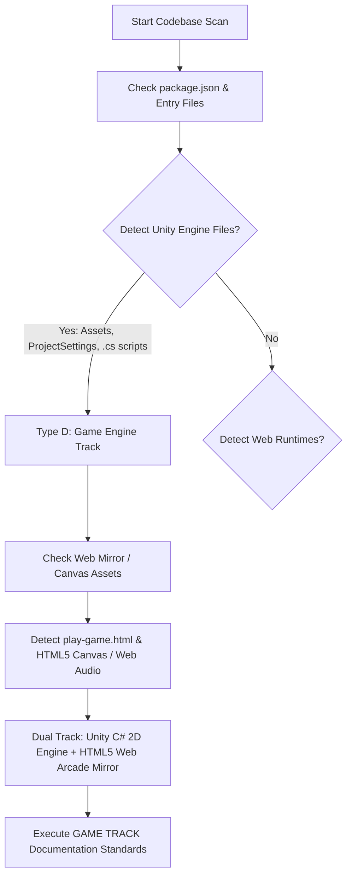

# Project Type Detection & Evidence Log

## 1. Project Type Determination

| Attribute | Detected Value | Verification Method |
| :--- | :--- | :--- |
| **Primary Project Category** | **Type D: Game** (Physics-based 2D Endless Flyer) | File extension analysis, engine assets, scripts |
| **Secondary Sub-category** | **Type B: Frontend / Standalone Web Client** | `play-game.html` standalone Canvas arcade mirror |
| **Primary Engine / Framework** | **Unity 5.6+ / 2D Engine** (C# Scripting) | `Assets/Scripts/*.cs`, `ProjectSettings/` |
| **Web Runtime** | **HTML5 2D Canvas & Web Audio API** | `41-flappy-bird-game/play-game.html` |
| **Server / Backend Presence** | **None (Client-Side Only)** | No Express/Node/Django server code present |
| **Database Presence** | **Browser LocalStorage (Client Persistence)** | `localStorage.getItem('flappy_best')` |
| **AI Integration Presence** | **No Native AI Integration** (Deterministic Arcade Physics) | Explained in `/docs/07-ai-integration.md` |

---

## 2. Hard Evidence from Codebase

### Evidence A: Unity Engine Artifacts
1. **Scene File**: `41-flappy-bird-game/Assets/Scenes/mainGame.unity` — Binary/YAML serialized Unity scene containing Main Camera, Flappy Bird player GameObject with Rigidbody2D, Spawner, Floor, Background, and Canvas UI.
2. **Engine Settings**: `41-flappy-bird-game/ProjectSettings/ProjectSettings.asset`, `TagManager.asset`, `InputManager.asset` — Native Unity project configuration files.
3. **C# Engine Script Components**:
   - `41-flappy-bird-game/Assets/Scripts/FlappyScript.cs` (Lines 1–187): Inherits `MonoBehaviour`, uses `Rigidbody2D`, `Collider2D`, `Time.deltaTime`, `Input.GetButtonUp("Jump")`, `AudioSource.PlayOneShot()`.
   - `41-flappy-bird-game/Assets/Scripts/SpawnerScript.cs` (Lines 1–31): Implements procedural spawning using `Instantiate()` and `Random.Range()`.
   - `41-flappy-bird-game/Assets/Scripts/ScoreManagerScript.cs` (Lines 1–47): 3-digit score renderer slicing number sprites.
   - `41-flappy-bird-game/Assets/Scripts/GameState.cs` (Lines 1–27): Global static state machine (`Intro`, `Playing`, `Dead`).
   - `41-flappy-bird-game/Assets/Scripts/CameraFollow.cs` (Lines 1–22): Smooth X-axis camera tracking.
   - `41-flappy-bird-game/Assets/Scripts/FloorMoveScript.cs` (Lines 1–28): Infinite looping conveyor ground.
   - `41-flappy-bird-game/Assets/Scripts/PipeDestroyerScript.cs` (Lines 1–17): Trigger-based garbage collection for offscreen pipes.
   - `41-flappy-bird-game/Assets/Scripts/RandomBackgroundScript.cs` (Lines 1–18): Procedural day/night sprite swapping.
4. **Animation & Prefab Assets**:
   - `Assets/Animations/flappyAnimation.anim`, `Assets/Animations/sprites_58.controller`
   - `Assets/Prefabs/PipeColumnPrefab.prefab`, `Assets/Prefabs/PipeColumnPrefab2.prefab`

### Evidence B: Web Arcade Mirror Artifacts
1. **HTML5 Canvas Arcade**: `41-flappy-bird-game/play-game.html` (Lines 1–520):
   - Direct DOM 2D Canvas: `<canvas id="gameCanvas" width="288" height="512">`
   - Master Game Loop: `requestAnimationFrame(loop)` driving deterministic `update()` and `render()` passes.
   - Audio Pipeline: Multi-source `HTMLAudioElement` (`sndFly`, `sndDeath`, `sndScored`) backed by custom `AudioContext` Web Audio API oscillator synthesis fallback.
   - Persistence: `localStorage.getItem('flappy_best')` storing session records.

---

## 3. Applicable Documentation Tracks

Following the Master Documentation Specification:
- **GAME TRACK Activated**: Deep technical analysis of game loops, fixed vs. variable timesteps, Box2D physics simulation, axis-aligned bounding box (AABB) collisions, procedural pipe generation, object lifecycles, and 40+ game developer interview questions.
- **Frontend / Client Architecture Activated**: Detailed evaluation of canvas rendering, sprite sheet UV mapping, Web Audio synthesis, DOM event dispatching, and browser memory lifecycles.
- **System Design & Scaling Adapted**: Client-side asset delivery, CDN edge caching, and scalable architecture if multiplayer leaderboards and backend services were introduced.
- **Backend / Database / Auth / MERN Sections**: Marked explicitly as *"Not applicable for this project type"* with architectural justifications and scalability blueprints for future additions.
