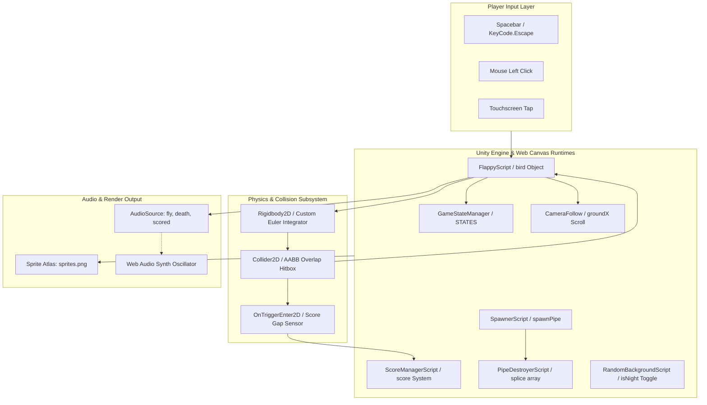
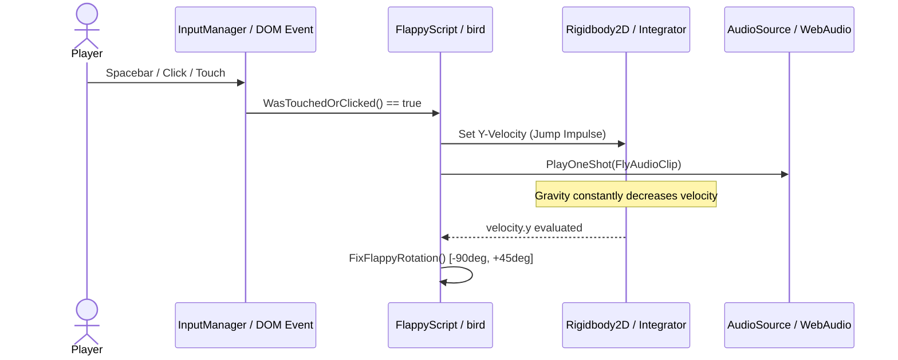
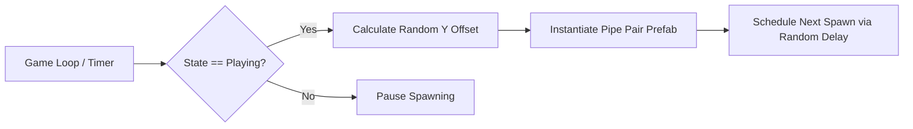
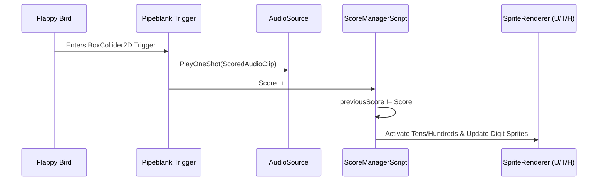
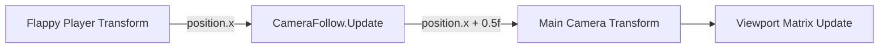
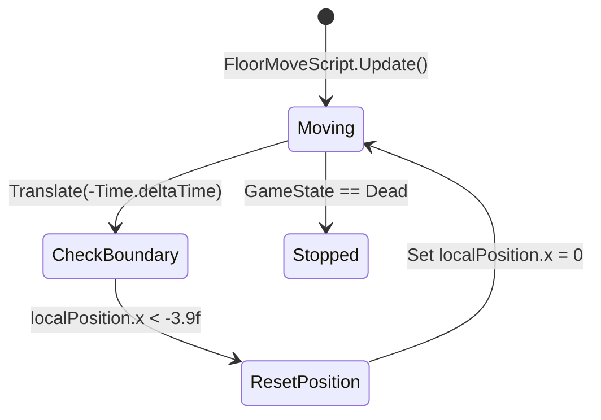
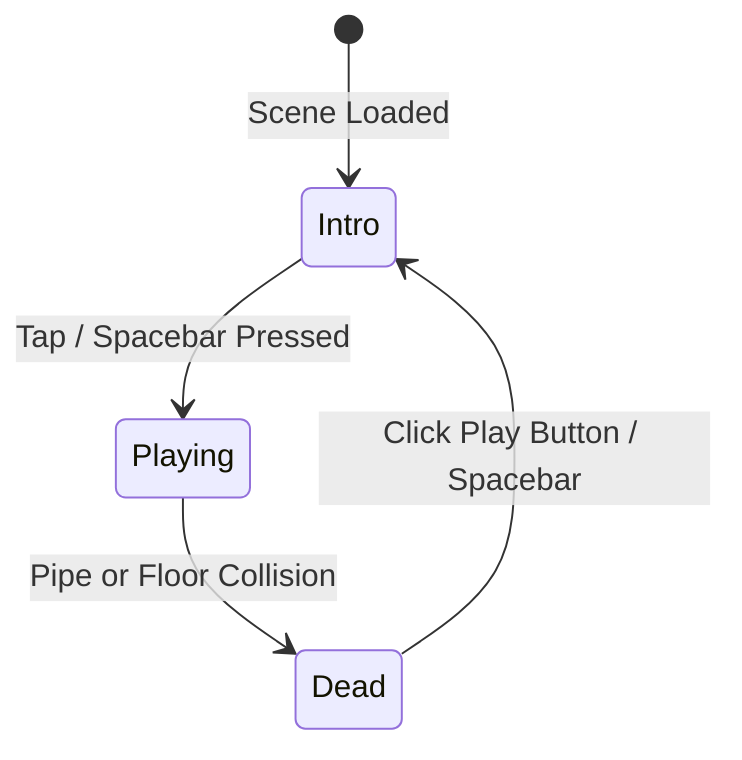
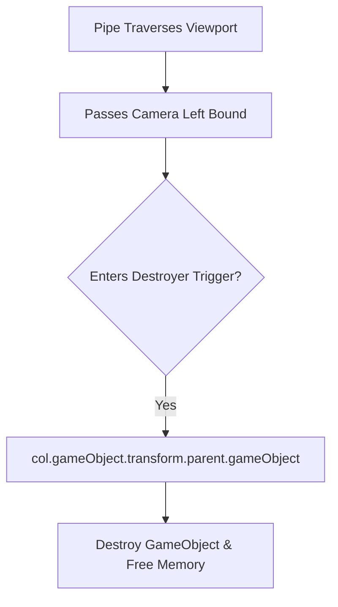
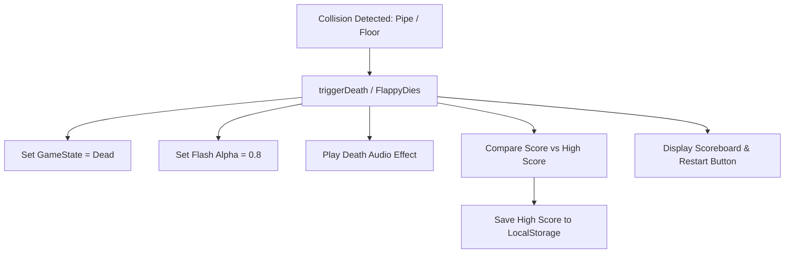

# Full Project Technical Analysis & Tracing



---

## 0.1 What the Project Is

- **Name**: Flappy Bird Style Game (Unity 5.6+ 2D Physics Edition & Web Arcade Mirror).
- **Core Purpose**: A high-precision recreational 2D obstacle-avoidance arcade game delivering responsive physics-driven flight mechanics, procedural obstacle generation, real-time score tracking, and immersive audio feedback.
- **Problem Solved**: Provides a clean, modern, zero-dependency reference implementation of classic arcade physics and state-driven game architecture across two distinct environments: native compiled C# (Unity Engine) and standard web runtime (HTML5 Canvas & Web Audio API).
- **Target Users**: Arcade gaming enthusiasts, game physics researchers, frontend engineers exploring game loop mechanics, and interviewers evaluating real-time systems programming.
- **Main User Journeys**:
  1. *Journey 1 (Intro to Play)*: Player launches the game &rarr; Views title banner and bird hovering in rhythmic idle bobbing &rarr; Inputs jump action (Space, Click, Tap) &rarr; Game transitions to `Playing` state, pipes start spawning, bird receives upward velocity impulse.
  2. *Journey 2 (Active Obstacle Evasion & Scoring)*: Player rhythmically pulses jump inputs &rarr; Bird rotates dynamically up (+45°) and noses downward (-90°) &rarr; Successfully navigates between pipe pairs &rarr; Clears invisible trigger zone &rarr; Plays score chime and increments score digits.
  3. *Journey 3 (Collision & Game Over)*: Bird collides with a pipe obstacle or the floor ground collider &rarr; Engine captures collision event &rarr; Immediate transition to `Dead` state &rarr; Camera stops, Death audio triggers, white impact flash displays, scoreboard panel renders score vs best high score &rarr; Player taps Play button or Space to reload/restart.

---

## 0.2 Comprehensive Feature Trace (F1 – F10)

### F1: Player Flap Impulse & Kinematic Rotation Physics
- **What User Sees & Does**: Tapping Space, Left-Click, or Touch causes the bird to flap wings, gain upward lift, and tilt upward, subsequently pitching downward as gravity takes over.
- **Code Trace**:
  - Unity: `FlappyScript.cs` &rarr; `Update()` (Lines 52–60) checks `WasTouchedOrClicked()` (Lines 98–105).
  - Calls `BoostOnYAxis()` (Lines 112–116): sets `GetComponent<Rigidbody2D>().velocity = new Vector2(0, VelocityPerJump)` (default 3 m/s) and executes `AudioSource.PlayOneShot(FlyAudioClip)`.
  - In `FixedUpdate()` (Lines 83–96), invokes `FixFlappyRotation()` (Lines 123–146): checks `velocity.y > 0`. If positive, increments `degreesToAdd = 6 * RotateUpSpeed`; if falling, decrements `degreesToAdd = -3 * RotateDownSpeed`. Clamps Euler angles between `-90°` and `+45°`.
  - Web Mirror: `play-game.html` &rarr; `handleAction()` (Lines 295–307) invokes `bird.flap()` (Lines 212–215), setting `this.vy = this.jump` (-5.8 px/frame). `update()` (Lines 227–236) applies `this.vy += this.gravity` (0.28) and clamps rotation between `-0.45` rad and `+1.57` rad (+90°).
- **Failure Mode**: Input latency or dropped frames on low-spec hardware; mitigated through delta-time multiplied physics updates and fixed timestep execution.
- **Diagram**:


---

### F2: Procedural Obstacle Spawning with Random Y-Offsets
- **What User Sees & Does**: Obstacles (pairs of upper and lower green pipes) appear continuously ahead of the player at variable heights, demanding varying flight altitudes.
- **Code Trace**:
  - Unity: `SpawnerScript.cs` &rarr; `Start()` (Lines 8–12) selects prefab `SpawnObjects[Random.Range(0, SpawnObjects.Length)]` and invokes `Spawn()`.
  - `Spawn()` (Lines 14–23): if `GameStateManager.GameState == GameState.Playing`, computes randomized Y coordinate `float y = Random.Range(-0.5f, 1f)` and spawns pipe prefab at `this.transform.position + new Vector3(0, y, 0)`.
  - Reschedules itself via `Invoke("Spawn", Random.Range(timeMin, timeMax))` with interval `[0.7s, 2.0s]`.
  - Web Mirror: `play-game.html` &rarr; `update()` (Lines 344–349) tracks `pipeTimer++`. When `>= pipeSpawnInterval` (100 frames), calls `spawnPipe()` (Lines 262–272), computing random `topHeight` in range `[60, 260]`.
- **Diagram**:


---

### F3: Score Sensor Trigger & 3-Digit Graphic Rendering
- **What User Sees & Does**: Crossing safely between the upper and lower pipe awards 1 point, triggers a bright musical chime, and immediately increments the score display.
- **Code Trace**:
  - Unity: `FlappyScript.cs` &rarr; `OnTriggerEnter2D(Collider2D col)` (Lines 152–166): checks `col.gameObject.tag == "Pipeblank"`.
  - Executes `AudioSource.PlayOneShot(ScoredAudioClip)` and `ScoreManagerScript.Score++`.
  - `ScoreManagerScript.cs` &rarr; `Update()` (Lines 15–40): checks `previousScore != Score`. If `Score < 10`, renders `Units.sprite = numberSprites[Score]`. If `10 <= Score < 100`, activates `Tens` sprite renderer and sets `Tens.sprite = numberSprites[Score / 10]`, `Units.sprite = numberSprites[Score % 10]`. If `Score >= 100`, activates `Hundreds` and splits hundreds, tens, and units.
  - Web Mirror: `play-game.html` &rarr; Lines 373–377: evaluates `!p.passed && p.x + p.w < bird.x`. Sets `p.passed = true`, increments `score++`, invokes `playBeep('score')`.
- **Diagram**:


---

### F4: Smooth Horizontal Camera Tracking System
- **What User Sees & Does**: The camera moves continuously forward with the bird, giving the illusion of flying across an endless landscape.
- **Code Trace**:
  - Unity: `CameraFollow.cs` &rarr; `Start()` (Lines 7–10) captures `cameraZ = transform.position.z` (-10f).
  - In `Update()` (Lines 14–17), aligns camera position: `transform.position = new Vector3(Player.position.x + 0.5f, 0, cameraZ)`.
  - The `+ 0.5f` offset positions the player slightly to the left of center, maximizing forward visibility.
- **Diagram**:


---

### F5: Seamless Infinite Looping Ground Scrolling
- **What User Sees & Does**: The striped ground conveyor continuously moves leftward beneath the player and seamlessly repeats without visible seams.
- **Code Trace**:
  - Unity: `FloorMoveScript.cs` &rarr; `Update()` (Lines 14–24): if `GameStateManager.GameState == GameState.Dead`, exits.
  - Checks `if (transform.localPosition.x < -3.9f)`, wraps back to origin `transform.localPosition = new Vector3(0, y, z)`.
  - Translates leftward via `transform.Translate(-Time.deltaTime, 0, 0)`.
  - Web Mirror: `play-game.html` (Lines 338, 341): `groundX = (groundX + groundSpeed) % (168 * 2)`. Render loop (Lines 442–444) tiles ground slices across screen width.
- **Diagram**:


---

### F6: Global Game State Lifecycle Manager
- **What User Sees & Does**: The game manages 3 discrete phases: Intro (hovering bird, prompt text), Playing (active obstacles and physics), and Dead (scoreboard, freeze, restart button).
- **Code Trace**:
  - Unity: `GameState.cs` &rarr; Defines enum `GameState { Intro, Playing, Dead }` and static wrapper `GameStateManager.GameState`.
  - `FlappyScript.cs` evaluates state in `Update()` and `FixedUpdate()`:
    - *Intro*: Bird hovers via vertical force pulse (`velocity.y < -1` &rarr; `AddForce(0, mass * 5500 * dt)`). Tap switches state to `Playing`, activates physics, hides `IntroGUI`.
    - *Playing*: Full physics and obstacle collision active.
    - *Dead*: Ground stops moving, input checks for restart collider tap &rarr; `Application.LoadLevel(Application.loadedLevelName)`.
  - Web Mirror: `play-game.html` &rarr; `STATES = { INTRO: 0, PLAYING: 1, DEAD: 2 }`.
- **Diagram**:


---

### F7: Offscreen Pipe Recycling & Garbage Cleanup
- **What User Sees & Does**: Behind the scenes, cleared pipes that move past the left edge of the screen are safely removed from memory to prevent memory leaks and performance degradation.
- **Code Trace**:
  - Unity: `PipeDestroyerScript.cs` &rarr; `OnTriggerEnter2D(Collider2D col)` (Lines 10–15): attaches to an invisible barrier trailing behind the camera.
  - Checks `if (col.tag == "Pipe" || col.tag == "Pipeblank")`, then calls `Destroy(col.gameObject.transform.parent.gameObject)`.
  - Web Mirror: `play-game.html` &rarr; Lines 380–382: checks `if (p.x + p.w < -10) pipes.splice(i, 1)`.
- **Diagram**:


---

### F8: Procedural Day / Night Sky Randomizer
- **What User Sees & Does**: Each play session dynamically selects either a bright daytime city backdrop or a deep dark nighttime theme. In the web version, pressing `T` toggles the sky instantly.
- **Code Trace**:
  - Unity: `RandomBackgroundScript.cs` &rarr; `Start()` (Lines 7–9): picks random sprite from `Backgrounds` array: `(GetComponent<Renderer>() as SpriteRenderer).sprite = Backgrounds[Random.Range(0, Backgrounds.Length)]`.
  - Web Mirror: `play-game.html` &rarr; Line 188: `let isNight = Math.random() > 0.5;`. Line 313: `KeyT` toggles `isNight = !isNight`.
- **Diagram**:
```mermaid
flowchart LR
    A[Scene Init / Key 'T'] --> B{Random Seed / Toggle}
    B -- Day --> C[Select SPRITES.bgDay (sx: 0, sy: 0)]
    B -- Night --> D[Select SPRITES.bgNight (sx: 146, sy: 0)]
    C --> E[Render Sky Canvas Layer]
    D --> E
```

---

### F9: Fatal Collision Sequence & Scoreboard Summary
- **What User Sees & Does**: Crashing into any pipe or touching the ground triggers an immediate screen flash, a death crash sound, freezes movement, drops the bird to the dirt, and displays the high score summary.
- **Code Trace**:
  - Unity: `FlappyScript.cs` &rarr; `OnTriggerEnter2D` (tag "Pipe") and `OnCollisionEnter2D` (tag "Floor") invoke `FlappyDies()` (Lines 179–184).
  - Sets `GameStateManager.GameState = GameState.Dead`, enables `DeathGUI.SetActive(true)`, plays `DeathAudioClip`.
  - Web Mirror: `play-game.html` &rarr; `triggerDeath()` (Lines 274–283): sets `gameState = STATES.DEAD`, triggers `flashAlpha = 0.8`, plays `playBeep('death')`, updates `localStorage.setItem('flappy_best', highScore)`.
- **Diagram**:


---

### F10: Dual Web Audio Engine & Synthesis Fallback
- **What User Sees & Does**: Audio sounds crisply regardless of whether the browser allows MP3 decoding from `file://` or requires programmatic synthesizer tones.
- **Code Trace**:
  - Web Mirror: `play-game.html` &rarr; Lines 126–164: defines `sndFly`, `sndDeath`, `sndScored` via `new Audio()`.
  - `playBeep(type)`: attempts `sndFly.play()`. If rejected due to autoplay policy or security restriction on local file protocol, catches error and calls `synthSound(freq, dur, type)` via Web Audio API `AudioContext`.
  - `synthSound()` builds an `OscillatorNode` (triangle, sine, sawtooth) routed through a `GainNode` with exponential decay envelope.
- **Diagram**:
```mermaid
flowchart TD
    A[playBeep Action] --> B{HTMLAudioElement.play()}
    B -- Resolved --> C[Native MP3 Output]
    B -- Rejected / Blocked --> D[Catch Block Activated]
    D --> E[Web Audio AudioContext]
    E --> F[OscillatorNode + GainNode Envelope]
    F --> G[Synthesized Chime Output]
```

---

## 0.3 Engine & Web APIs Overview

### Engine & Client-Side APIs Table
| Subsystem | API / Method | Caller File & Line | Purpose |
| :--- | :--- | :--- | :--- |
| **Unity Physics** | `Rigidbody2D.velocity` | `FlappyScript.cs:114` | Sets instantaneous vertical jump impulse |
| **Unity Physics** | `Rigidbody2D.AddForce` | `FlappyScript.cs:89` | Introduces buoyant oscillation during Intro state |
| **Unity Audio** | `AudioSource.PlayOneShot` | `FlappyScript.cs:115,158,183` | Plays non-looping sound effects on dedicated channels |
| **Unity Lifecycle** | `Application.LoadLevel` | `FlappyScript.cs:76` | Reloads active game scene on restart |
| **Unity Input** | `Input.GetButtonUp("Jump")` | `FlappyScript.cs:100` | Captures cross-platform Spacebar / controller jump |
| **Unity Raycast** | `Physics2D.OverlapPoint` | `FlappyScript.cs:72` | Evaluates UI collider contact for restart button |
| **Web Canvas** | `CanvasRenderingContext2D.drawImage` | `play-game.html:403` | Renders sliced sprite atlas frames to canvas |
| **Web Audio** | `AudioContext.createOscillator` | `play-game.html:154` | Generates procedural fallback waveforms |
| **Web Storage** | `localStorage.getItem/setItem` | `play-game.html:190,281` | Persists all-time best score across sessions |

---

## 0.4 Helpers, State Managers & Shared Systems

1. **`GameStateManager` (`GameState.cs:14–25`)**: Global static container providing cross-script synchronization between physics, spawning, ground motion, and UI.
2. **`ScoreManagerScript` (`ScoreManagerScript.cs:4–46`)**: Static score counter decoupling score increments from rendering calculations.
3. **`play-game.html:SPRITES` (`play-game.html:167–183`)**: Sprite Atlas coordinate mapping lookup table defining sub-rectangle UV bounds for 2D Canvas blitting.

---

## 0.5 Final Inventory Counts

| Category | Exact Count | Codebase Reference |
| :--- | :--- | :--- |
| **Game Scenes / Pages** | **2** | `mainGame.unity` & `play-game.html` |
| **C# Engine Script Components** | **8** | `Assets/Scripts/*.cs` |
| **Distinct Features (F1–F10)** | **10** | Documented F1 through F10 |
| **Prefabs** | **2** | `PipeColumnPrefab.prefab`, `PipeColumnPrefab2.prefab` |
| **Audio Clips** | **3** | `fly.mp3`, `death.mp3`, `scored.mp3` |
| **Sprites in Atlas** | **80 sliced / 1 master** | `Assets/Sprites/sprites.png` (512x512) |
| **Game States** | **3** | `Intro`, `Playing`, `Dead` |
| **External Dependencies** | **0** | Zero npm dependencies, pure native C# & HTML5 Canvas |
