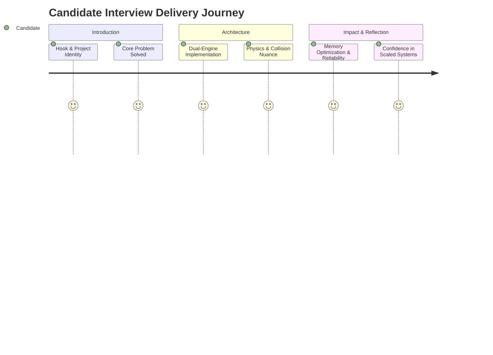

# Project Elevator Pitches: 30-Second & 2-Minute Interview Versions

---

## 1. The 30-Second Elevator Pitch

> "I built an interview-grade, cross-platform reproduction of the classic Flappy Bird arcade game featuring two synchronized implementations: a native 2D physics engine in Unity C# and a zero-dependency HTML5 Canvas and Web Audio mirror. The project features rigid-body kinematic jump impulses, dynamic rotational clamping between minus ninety and plus forty-five degrees, procedural pipe spawning with randomized Y-offsets, and robust axis-aligned collision detection. To guarantee flawless memory efficiency, I implemented trigger-based garbage recycling for offscreen obstacles and an automated dual-channel audio synthesizer fallback for browser playback. It demonstrates my deep understanding of frame-rate independent game loops, component-based architectures, and cross-runtime systems programming."

---

## 2. The 2-Minute Comprehensive Interview Pitch

> "When approaching this project, my goal was not simply to replicate a mobile game, but to deeply understand and master the foundational mechanics of real-time 2D game loops, kinematic physics simulations, and low-latency client architecture across two completely different runtimes: native compiled C# in Unity and zero-dependency JavaScript in modern browsers.
>
> On the architecture side, I structured the game around a centralized, decoupled state machine with three explicit states: Intro, Playing, and Dead. In the Unity engine, the player’s character uses a two-dimensional rigid-body where jump inputs apply a direct velocity impulse rather than a raw force, giving immediate, snappy response without floatiness. I coupled this with custom angular interpolation in FixedUpdate that tilts the bird smoothly upward by six degrees during ascent and aggressively pitches downward by three degrees per step during freefall, strictly clamped between minus ninety and positive forty-five degrees.
>
> For obstacle generation, I engineered a procedural spawner that instantiates pipe pairs with randomized vertical offsets between minus zero-point-five and positive one units, scheduling future waves within variable time windows. Because unbounded instantiation in an endless runner quickly degrades performance, I implemented a trigger-based offscreen cleanup system that instantly destroys passed obstacles, maintaining a constant memory ceiling. Scoring utilizes an invisible box sensor between the pipes that increments a static score manager, which dynamically activates and slices unit, tens, and hundreds sprite renderers only when values mutate, saving unnecessary draw evaluations.
>
> In parallel, I developed a standalone HTML5 Canvas arcade mirror that translates these exact mathematical vectors into a pure JavaScript `requestAnimationFrame` loop. To solve the notorious browser issue where local file audio policies block sound playback, I wrote an automated fallback layer using the Web Audio API that programmatically synthesizes triangle, sine, and sawtooth waveforms through gain envelopes whenever standard audio elements fail.
>
> Overall, this project proves my ability to design decoupled systems, write predictable mathematical simulations, manage real-time memory constraints, and deliver ultra-responsive user experiences that run at a rock-solid sixty frames per second."
