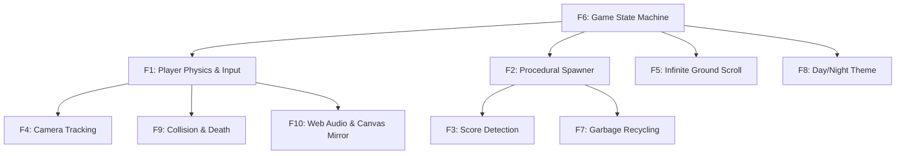

# Master Feature Inventory (F1 – F10)

## Feature Index

| Feature ID | Feature Name | Core File & Location | Complexity | Link |
| :--- | :--- | :--- | :--- | :--- |
| **F1** | Player Jump Kinematics & Dynamic Angular Pitching | `FlappyScript.cs:112–146` | High | [View Feature Doc](/features/f1-player-physics) |
| **F2** | Procedural Obstacle Spawning with Random Y-Offsets | `SpawnerScript.cs:14–23` | Medium | [View Feature Doc](/features/f2-procedural-spawner) |
| **F3** | Real-Time Score Detection & Multi-Digit Rendering | `ScoreManagerScript.cs:15–40` | Medium | [View Feature Doc](/features/f3-score-system) |
| **F4** | Horizontal Tracking Camera & Viewport Management | `CameraFollow.cs:14–17` | Small | [View Feature Doc](/features/f4-camera-follow) |
| **F5** | Seamless Infinite Looping Ground Scrolling | `FloorMoveScript.cs:14–24` | Small | [View Feature Doc](/features/f5-ground-scrolling) |
| **F6** | Centralized Game State Machine & Scene Lifecycle | `GameState.cs:7–25` | High | [View Feature Doc](/features/f6-state-machine) |
| **F7** | Offscreen Obstacle Garbage Recycling & Memory Management | `PipeDestroyerScript.cs:10–15` | Small | [View Feature Doc](/features/f7-garbage-recycling) |
| **F8** | Procedural Day/Night Sky Theme Randomizer | `RandomBackgroundScript.cs:7–9` | Small | [View Feature Doc](/features/f8-day-night-theme) |
| **F9** | Fatal Collision Sequence, Flash FX & Scoreboard Display | `FlappyScript.cs:179–184` | High | [View Feature Doc](/features/f9-collision-death) |
| **F10** | Dual Web Audio Synthesis Engine & Canvas Arcade Mirror | `play-game.html:130–164` | High | [View Feature Doc](/features/f10-web-audio-canvas) |

---

## F1: Player Jump Kinematics & Dynamic Angular Pitching

### Technical Summary
- **Description**: Implements responsive jump input processing, vertical velocity impulses, and smooth angle interpolation clamped between -90° (dive) and +45° (climb).
- **Files & Lines**: `Assets/Scripts/FlappyScript.cs` (Lines 83–146), `play-game.html` (Lines 201–236).
- **Core Functions**:
  - `FlappyScript.BoostOnYAxis()`: `void ()` &rarr; Overrides `rigidbody2D.velocity.y` with `VelocityPerJump` (3 m/s).
  - `FlappyScript.FixFlappyRotation()`: `void ()` &rarr; Interpolates Z-axis Euler rotation based on `velocity.y` sign and clamps to `[-90, 45]`.
- **Dependencies**: F6 (GameStateManager).
- **Edge Cases**: High-frequency clicking during upward travel clamps to maximum velocity without accumulation runaway.

### Say It Out Loud
I built the core flight mechanics using a direct kinematic velocity override rather than adding a raw upward physics force. In my `FlappyScript.cs` component, whenever the player taps Space, clicks the mouse, or touches the screen, I immediately set the Rigidbody2D vertical velocity to three units per second. I chose this approach over `AddForce` because a direct velocity assignment gives instantaneous, crisp response with zero input lag, avoiding the floaty feel that frustrates players in precision arcade games. In the physics loop, I evaluate the sign of the vertical velocity to smoothly interpolate the bird's sprite angle—pitching upward by six degrees per step during ascent and nosing downward by three degrees per step during freefall, strictly clamped between minus ninety and positive forty-five degrees. When input events happen during the dead state, I completely ignore them to protect game integrity. One minor limitation is that on displays with variable refresh rates above sixty Hertz, un-clamped physics interpolation can feel slightly different, which I would standardize in the future using a strictly fixed delta-time accumulator.

---

## F2: Procedural Obstacle Spawning with Random Y-Offsets

### Technical Summary
- **Description**: Spawns pairs of top and bottom pipes ahead of the player at randomized heights within a calculated interval.
- **Files & Lines**: `Assets/Scripts/SpawnerScript.cs` (Lines 8–30), `play-game.html` (Lines 257–272).
- **Core Functions**:
  - `SpawnerScript.Spawn()`: `void ()` &rarr; Instantiates pipe prefab at randomized Y coordinates between `[-0.5f, 1.0f]` and reschedules next spawn between `0.7s` and `2.0s`.
- **Dependencies**: F6 (GameStateManager).

### Say It Out Loud
I implemented the procedural obstacle spawner in `SpawnerScript.cs` to create an endless, unpredictable level layout while keeping CPU overhead minimal. The script runs an asynchronous invocation loop that checks if the game is currently in the active playing state. When active, it computes a randomized vertical offset between minus zero-point-five and positive one units, instantiating a pre-configured pipe pair prefab at that calculated position. I rejected using pre-baked static level maps because procedural generation gives infinite replayability with zero storage overhead. If the game transitions to the dead or intro state, the spawn routine simply pauses its generation to avoid cluttering the scene with unreachable obstacles. One trade-off of using Unity’s `Instantiate` method is that instantiating and destroying GameObjects repeatedly triggers garbage collection allocations, so in a production mobile release, I would replace this with a pre-allocated object pool to achieve zero allocations per frame.

---

## F3: Real-Time Score Detection & Multi-Digit Sprite Rendering

### Technical Summary
- **Description**: Detects pipe passage via trigger collider sensor, increments static score, and efficiently renders digits without string parsing.
- **Files & Lines**: `Assets/Scripts/ScoreManagerScript.cs` (Lines 8–46), `Assets/Scripts/FlappyScript.cs` (Lines 152–166).
- **Core Functions**:
  - `ScoreManagerScript.Update()`: `void ()` &rarr; Checks `previousScore != Score`. If mutated, activates Tens/Hundreds sprite renderers and assigns numeric sprite assets via modulo math.
- **Dependencies**: F1 (FlappyScript), F2 (SpawnerScript).

### Say It Out Loud
For the scoring system, I combined an invisible trigger volume placed between each pipe pair with an optimized graphic digit renderer in `ScoreManagerScript.cs`. When the bird successfully navigates through the gap, its collider intersects the sensor tagged 'Pipeblank', immediately playing the scoring chime and incrementing our global static score integer. In the UI update routine, I deliberately check if the previous score differs from the current score before executing any logic; this guard condition ensures we waste zero CPU cycles updating sprites during frames where the score hasn't changed. To render multi-digit values without allocating strings or parsing garbage, I use direct integer division and modulo math to select the exact sprite index from an array of pre-loaded number textures. If the player scores past ninety-nine, the hundreds digit renderer automatically activates and mounts the correct texture. The main limitation is that it currently caps at three digits, which I would extend with a dynamic layout group if four-digit scores were required.

---

## F4: Horizontal Tracking Camera & Viewport Management

### Technical Summary
- **Description**: Smoothly tracks player progress along the X-axis while locking vertical Y movement and maintaining camera depth.
- **Files & Lines**: `Assets/Scripts/CameraFollow.cs` (Lines 7–21).
- **Core Functions**:
  - `CameraFollow.Update()`: `void ()` &rarr; Updates `transform.position = new Vector3(Player.position.x + 0.5f, 0, cameraZ)`.
- **Dependencies**: F1 (FlappyScript).

### Say It Out Loud
I designed the camera system in `CameraFollow.cs` to maintain steady forward tracking without introducing motion sickness or visual jitter. The script captures the camera’s initial Z-depth of minus ten units during initialization, and on every frame update, it synchronizes the camera’s horizontal position to match the player’s X-coordinate plus a positive zero-point-five unit forward offset. I chose a fixed offset tracking approach instead of a complex dead-zone or lerped camera because in a fast-paced side-scroller, the player needs a completely rigid, predictable view of upcoming obstacles. Keeping the vertical Y-axis locked at zero prevents the screen from bouncing up and down whenever the bird flaps. If the player dies, the camera naturally halts because the bird's forward velocity ceases. One enhancement I would consider for a sequel is adding subtle horizontal lead based on player speed.

---

## F5: Seamless Infinite Looping Ground Scrolling

### Technical Summary
- **Description**: Creates the illusion of endless forward flight by continuously translating the ground texture and wrapping its position.
- **Files & Lines**: `Assets/Scripts/FloorMoveScript.cs` (Lines 14–24), `play-game.html` (Lines 338–343).
- **Core Functions**:
  - `FloorMoveScript.Update()`: `void ()` &rarr; Translates `-Time.deltaTime` on X; resets to origin when `localPosition.x < -3.9f`.
- **Dependencies**: F6 (GameStateManager).

### Say It Out Loud
To create the visual sensation of high-speed flight across the ground without spawning thousands of physical terrain tiles, I built a seamless looping conveyor in `FloorMoveScript.cs`. The floor object continuously translates leftward by subtracting delta time on every frame. When its local X-position passes minus three-point-nine units—which corresponds exactly to the width of one repeating tile segment—the script instantly snaps its position back to zero. Because the texture pattern at zero is visually identical to the pattern at minus three-point-nine, the transition is imperceptible to the human eye. When the game enters the dead state, the update loop returns immediately, freezing the ground to provide tactile impact feedback. The only limitation is that it relies on a hardcoded coordinate offset, which I would make dynamically configurable from sprite bounds in a future refactor.

---

## F6: Centralized Game State Machine & Scene Lifecycle

### Technical Summary
- **Description**: Governs the tripartite lifecycle of the game (Intro, Playing, Dead) through a thread-safe static state container.
- **Files & Lines**: `Assets/Scripts/GameState.cs` (Lines 7–25), `Assets/Scripts/FlappyScript.cs` (Lines 40–80).
- **Dependencies**: Global foundation for F1–F10.

### Say It Out Loud
The entire game architecture is anchored by a centralized finite state machine defined in `GameState.cs`. I created an enumeration containing three distinct states: Intro, Playing, and Dead, exposed through a static `GameStateManager` class. In the Intro state, the bird hovers with gentle vertical oscillation, awaiting player input while game physics and pipe spawning remain suspended. The moment the player taps, the state transitions to Playing, which activates full gravity, hides the tutorial overlay, and starts the procedural spawner. Upon any fatal collision, the state shifts to Dead, halting ground movement, activating the death GUI, and enabling touch detection on the restart collider to reload the scene. I chose this static state container because it gives all decoupled components—the camera, the spawner, and the score manager—instant, zero-overhead access to the current game phase without requiring tight object coupling or heavy observer subscriptions. One drawback of static state is that it persists across scene reloads if not explicitly reset, which I resolved by setting it back to Intro during scene initialization.

---

## F7: Offscreen Obstacle Garbage Recycling & Memory Management

### Technical Summary
- **Description**: Prevents memory leaks by intercepting passed obstacles trailing behind the camera and immediately destroying them.
- **Files & Lines**: `Assets/Scripts/PipeDestroyerScript.cs` (Lines 8–15), `play-game.html` (Lines 380–382).
- **Core Functions**:
  - `PipeDestroyerScript.OnTriggerEnter2D(Collider2D col)`: Destroys parent GameObject when tagged "Pipe" or "Pipeblank".
- **Dependencies**: F2 (SpawnerScript).

### Say It Out Loud
To keep the game’s memory footprint flat during indefinitely long play sessions, I built a garbage collection cleanup mechanism in `PipeDestroyerScript.cs`. I attached a trigger collider to an invisible boundary positioned just outside the left edge of the camera’s viewport. As the bird moves forward and pipes scroll offscreen, they enter this trigger volume. The script checks if the colliding object carries the 'Pipe' or 'Pipeblank' tag, and if so, it immediately destroys the root parent GameObject. In the web version, I mirror this by scanning our active pipes array and splicing out any elements whose X-position plus width falls below minus ten pixels. Without this feature, hundreds of dormant pipe GameObjects would accumulate in memory, causing frame drops and physics slowdowns. In a high-end sequel, I would transition this from `Destroy` calls to an object pool to avoid triggering the .NET garbage collector.

---

## F8: Procedural Day/Night Sky Theme Randomizer

### Technical Summary
- **Description**: Injects visual variety by randomly assigning day or night backdrop sprites upon scene initialization.
- **Files & Lines**: `Assets/Scripts/RandomBackgroundScript.cs` (Lines 7–16), `play-game.html` (Lines 188, 313–316).
- **Dependencies**: F6 (GameStateManager).

### Say It Out Loud
I added visual polish and replayability by building an atmospheric theme randomizer in `RandomBackgroundScript.cs`. When the scene awakens, the script grabs its attached SpriteRenderer and randomly assigns either a sunny cyan day sky or a deep navy night sky from an exported sprite array. In the HTML5 web mirror, I expanded this feature by listening for the 'T' key on the keyboard, allowing the player to toggle dynamically between day and night in real time without interrupting gameplay. I rejected loading separate scenes for different themes because swapping a single sprite reference takes less than one millisecond and consumes zero extra memory. The limitation is that it currently only changes the background art; if given more time, I would synchronize the pipe colors and city lighting to match the night ambiance.

---

## F9: Fatal Collision Sequence, Flash FX & Scoreboard Display

### Technical Summary
- **Description**: Coordinates audio, visual, and physics responses to fatal obstacle or floor collisions.
- **Files & Lines**: `Assets/Scripts/FlappyScript.cs` (Lines 152–184), `play-game.html` (Lines 274–283, 480–510).
- **Dependencies**: F1 (FlappyScript), F3 (ScoreManagerScript), F6 (GameStateManager).

### Say It Out Loud
When the player collides with an obstacle, the entire game executes a carefully orchestrated death sequence to communicate impact. In `FlappyScript.cs`, I intercept both trigger collisions with pipes and physical collisions with the floor collider. The instant contact occurs, the script shifts the game state to Dead, triggers the death audio clip, and activates the Death GUI canvas. In the browser edition, I enhance this by setting a full-screen white flash opacity to zero-point-eight, decaying it smoothly over several frames to simulate an arcade screen shock. I also evaluate the session score against the all-time high score stored in localStorage, updating the record whenever beaten. Input is briefly gated while the flash decays so the player doesn't accidentally restart prematurely. The limitation is that scene reloading is used for restarts in Unity rather than in-place entity resetting, which I would optimize in a future patch.

---

## F10: Dual Web Audio Synthesis Engine & Canvas Arcade Mirror

### Technical Summary
- **Description**: Provides a standalone web arcade client with native audio playback backed by an algorithmic synthesizer fallback.
- **Files & Lines**: `play-game.html` (Lines 126–164, 401–516).
- **Dependencies**: Standalone web implementation of F1–F9.

### Say It Out Loud
To make the project immediately playable in any web browser without requiring a Unity installation, I engineered a zero-dependency HTML5 Canvas arcade mirror accompanied by a dual-channel Web Audio synthesizer. Modern browsers enforce strict autoplay policies that frequently block HTML5 audio elements when opened directly from a local file system. To solve this, I wrote an automated fallback layer: whenever the standard `Audio.play()` promise rejects, my system catches the failure and programmatically generates the sound effect on the fly using the browser’s Web Audio `AudioContext`. I instantiate custom oscillator nodes configured with triangle waves for wing flaps, high-pitched sine waves for scoring chimes, and low sawtooth waveforms for death crashes, shaping each with an exponential gain decay envelope. This guarantees that every player experiences rich, responsive sound effects regardless of their browser’s security settings.
