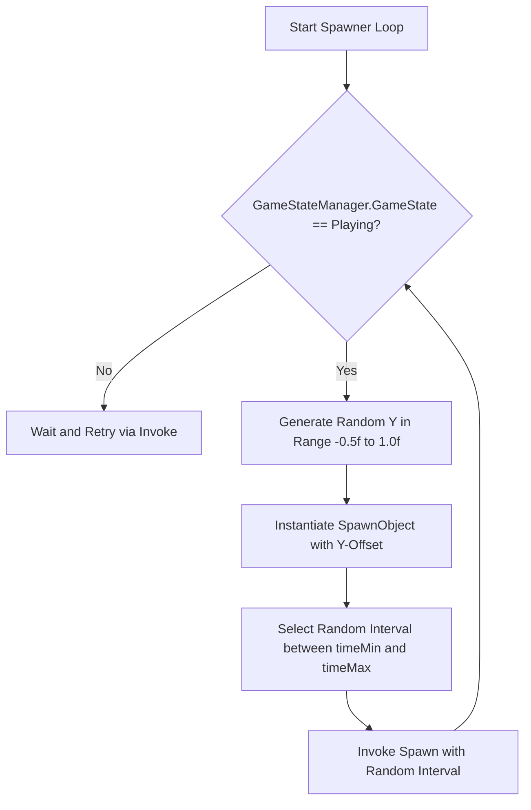

# F2: Procedural Obstacle Spawning with Random Y-Offsets



---

## 1. Feature Specifications

| Field | Detail |
| :--- | :--- |
| **Feature ID** | **F2** |
| **Feature Name** | Procedural Obstacle Spawning with Random Y-Offsets |
| **User-Facing Behavior** | Top and bottom green pipe columns appear continuously ahead of the player at fluctuating heights, demanding varied flight altitudes. |
| **Files Involved** | `41-flappy-bird-game/Assets/Scripts/SpawnerScript.cs` (Lines 1–31)<br>`41-flappy-bird-game/play-game.html` (Lines 257–272) |
| **Dependencies** | F6 (GameStateManager) |

---

## 2. Deep Function Trace

### `SpawnerScript.Start()`
- **Location**: `SpawnerScript.cs:8–12`
- **Logic**:
  ```csharp
  SpawnObject = SpawnObjects[Random.Range(0, SpawnObjects.Length)];
  Spawn();
  ```
- **Purpose**: Picks a prefab variant from the assigned array and starts the recursive timer cycle.

### `SpawnerScript.Spawn()`
- **Location**: `SpawnerScript.cs:14–23`
- **Signature**: `void Spawn()`
- **Logic**:
  ```csharp
  if (GameStateManager.GameState == GameState.Playing)
  {
      float y = Random.Range(-0.5f, 1f);
      GameObject go = Instantiate(SpawnObject, this.transform.position + new Vector3(0, y, 0), Quaternion.identity) as GameObject;
  }
  Invoke("Spawn", Random.Range(timeMin, timeMax));
  ```
- **Parameters**: `timeMin = 0.7f`, `timeMax = 2f`.
- **Why this exists**: Provides unpredictable, randomized obstacle layouts while guaranteeing that gaps remain within physically navigable bounds.

---

## 3. Say It Out Loud

I implemented the procedural obstacle spawner in `SpawnerScript.cs` to create an endless, unpredictable level layout while keeping CPU overhead minimal. The script runs an asynchronous invocation loop that checks if the game is currently in the active playing state. When active, it computes a randomized vertical offset between minus zero-point-five and positive one units, instantiating a pre-configured pipe pair prefab at that calculated position. I rejected using pre-baked static level maps because procedural generation gives infinite replayability with zero storage overhead. If the game transitions to the dead or intro state, the spawn routine simply pauses its generation to avoid cluttering the scene with unreachable obstacles. One trade-off of using Unity’s `Instantiate` method is that instantiating and destroying GameObjects repeatedly triggers garbage collection allocations, so in a production mobile release, I would replace this with a pre-allocated object pool to achieve zero allocations per frame.
