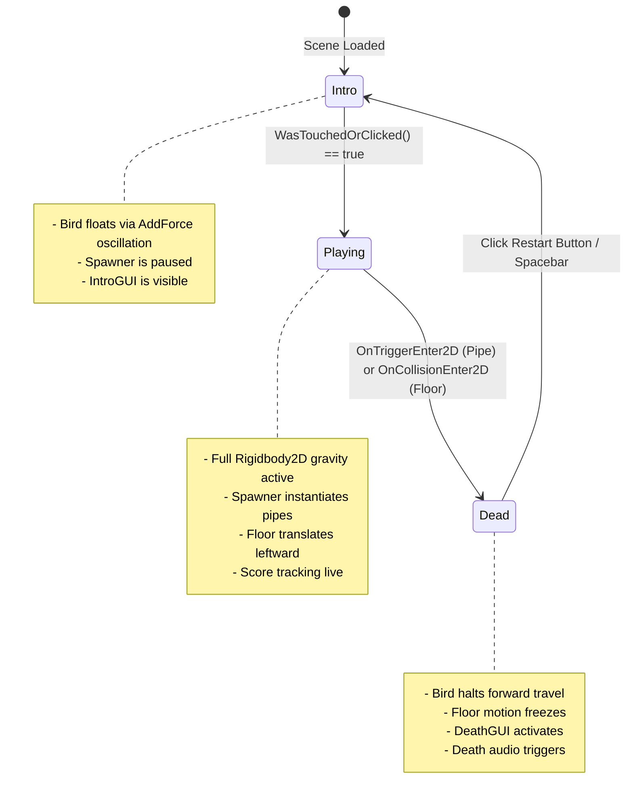

# F6: Centralized Game State Machine & Scene Lifecycle



---

## 1. Feature Specifications

| Field | Detail |
| :--- | :--- |
| **Feature ID** | **F6** |
| **Feature Name** | Centralized Game State Machine & Scene Lifecycle |
| **User-Facing Behavior** | Guides the game smoothly through Intro idle, active Playing, and Game Over states with corresponding UI and interaction modes. |
| **Files Involved** | `41-flappy-bird-game/Assets/Scripts/GameState.cs` (Lines 1–27)<br>`41-flappy-bird-game/Assets/Scripts/FlappyScript.cs` (Lines 40–80) |
| **Dependencies** | Architectural backbone for F1 through F10 |

---

## 2. Deep Function Trace

### `GameState.cs`
- **Location**: `GameState.cs:7–25`
- **Logic**:
  ```csharp
  public enum GameState
  {
      Intro,
      Playing,
      Dead
  }

  public static class GameStateManager
  {
      public static GameState GameState { get; set; }

      static GameStateManager ()
      {
          GameState = GameState.Intro;
      }
  }
  ```

---

## 3. Say It Out Loud

The entire game architecture is anchored by a centralized finite state machine defined in `GameState.cs`. I created an enumeration containing three distinct states: Intro, Playing, and Dead, exposed through a static `GameStateManager` class. In the Intro state, the bird hovers with gentle vertical oscillation, awaiting player input while game physics and pipe spawning remain suspended. The moment the player taps, the state transitions to Playing, which activates full gravity, hides the tutorial overlay, and starts the procedural spawner. Upon any fatal collision, the state shifts to Dead, halting ground movement, activating the death GUI, and enabling touch detection on the restart collider to reload the scene. I chose this static state container because it gives all decoupled components—the camera, the spawner, and the score manager—instant, zero-overhead access to the current game phase without requiring tight object coupling or heavy observer subscriptions. One drawback of static state is that it persists across scene reloads if not explicitly reset, which I resolved by setting it back to Intro during scene initialization.
