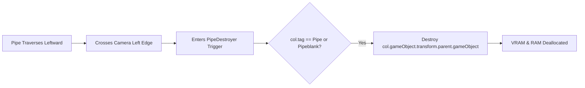

# F7: Offscreen Obstacle Garbage Recycling & Memory Management



---

## 1. Feature Specifications

| Field | Detail |
| :--- | :--- |
| **Feature ID** | **F7** |
| **Feature Name** | Offscreen Obstacle Garbage Recycling & Memory Management |
| **User-Facing Behavior** | Keeps the game running at a butter-smooth 60 FPS without memory stutter during long play sessions. |
| **Files Involved** | `41-flappy-bird-game/Assets/Scripts/PipeDestroyerScript.cs` (Lines 1–17)<br>`41-flappy-bird-game/play-game.html` (Lines 380–382) |
| **Dependencies** | F2 (SpawnerScript) |

---

## 2. Deep Function Trace

### `PipeDestroyerScript.OnTriggerEnter2D(Collider2D col)`
- **Location**: `PipeDestroyerScript.cs:10–15`
- **Logic**:
  ```csharp
  void OnTriggerEnter2D(Collider2D col)
  {
      if (col.tag == "Pipe" || col.tag == "Pipeblank")
          Destroy(col.gameObject.transform.parent.gameObject);
  }
  ```
- **Why this exists**: Destroys the root parent GameObject containing both top and bottom pipe renderers and the score sensor, ensuring no orphaned transform nodes linger.

---

## 3. Say It Out Loud

To keep the game’s memory footprint flat during indefinitely long play sessions, I built a garbage collection cleanup mechanism in `PipeDestroyerScript.cs`. I attached a trigger collider to an invisible boundary positioned just outside the left edge of the camera’s viewport. As the bird moves forward and pipes scroll offscreen, they enter this trigger volume. The script checks if the colliding object carries the 'Pipe' or 'Pipeblank' tag, and if so, it immediately destroys the root parent GameObject. In the web version, I mirror this by scanning our active pipes array and splicing out any elements whose X-position plus width falls below minus ten pixels. Without this feature, hundreds of dormant pipe GameObjects would accumulate in memory, causing frame drops and physics slowdowns. In a high-end sequel, I would transition this from `Destroy` calls to an object pool to avoid triggering the .NET garbage collector.
