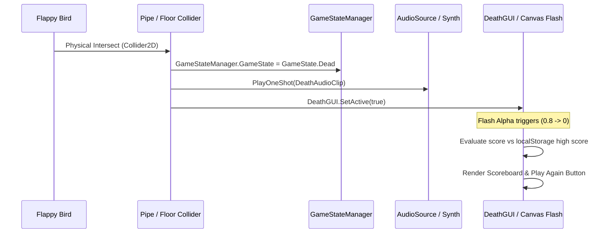

# F9: Fatal Collision Sequence, Flash FX & Scoreboard Display



---

## 1. Feature Specifications

| Field | Detail |
| :--- | :--- |
| **Feature ID** | **F9** |
| **Feature Name** | Fatal Collision Sequence, Flash FX & Scoreboard Display |
| **User-Facing Behavior** | Touching any pipe or floor immediately causes an impactful screen shock flash, halts gameplay, drops the bird, and reveals the final score vs personal best. |
| **Files Involved** | `41-flappy-bird-game/Assets/Scripts/FlappyScript.cs` (Lines 152–184)<br>`41-flappy-bird-game/play-game.html` (Lines 274–283, 480–510) |
| **Dependencies** | F1 (FlappyScript), F3 (ScoreManagerScript), F6 (GameStateManager) |

---

## 2. Deep Function Trace

### `FlappyScript.FlappyDies()`
- **Location**: `FlappyScript.cs:179–184`
- **Logic**:
  ```csharp
  void FlappyDies()
  {
      GameStateManager.GameState = GameState.Dead;
      DeathGUI.SetActive(true);
      GetComponent<AudioSource>().PlayOneShot(DeathAudioClip);
  }
  ```

---

## 3. Say It Out Loud

When the player collides with an obstacle, the entire game executes a carefully orchestrated death sequence to communicate impact. In `FlappyScript.cs`, I intercept both trigger collisions with pipes and physical collisions with the floor collider. The instant contact occurs, the script shifts the game state to Dead, triggers the death audio clip, and activates the Death GUI canvas. In the browser edition, I enhance this by setting a full-screen white flash opacity to zero-point-eight, decaying it smoothly over several frames to simulate an arcade screen shock. I also evaluate the session score against the all-time high score stored in localStorage, updating the record whenever beaten. Input is briefly gated while the flash decays so the player doesn't accidentally restart prematurely. The limitation is that scene reloading is used for restarts in Unity rather than in-place entity resetting, which I would optimize in a future patch.
