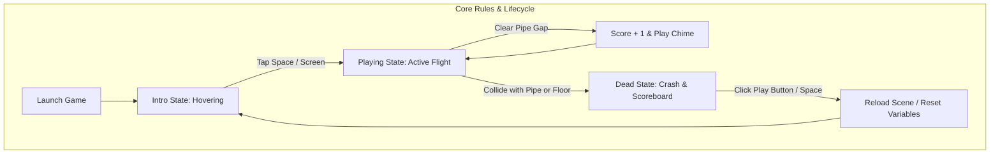

# Game Overview: Mechanics, Rules & Specifications

---

## 1. Executive Summary & Genre Classification

- **Genre**: 2D Physics-Driven Endless Runner / Obstacle Avoidance Arcade Game.
- **Primary Goal**: Navigate a flight-capable avatar (the bird) horizontally between endless vertical pipe obstacles without colliding with any obstacle surface or the ground terrain.
- **Victory Condition**: None (Endless arcade high-score chase).
- **Defeat Condition**: Any physical contact with a pipe obstacle collider or the ground terrain collider immediately terminates the run.
- **Target Experience**: High-intensity, micro-rhythmic precision flying emphasizing sub-millisecond reaction times and intuitive kinematic trajectory control.

---

## 2. Rules, Controls & Scoring

### Game Controls Matrix
| Action | Keyboard | Mouse | Mobile Touch | Gamepad |
| :--- | :--- | :--- | :--- | :--- |
| **Flap / Jump** | `Spacebar` / `Up Arrow` | Left Mouse Button Click | Single Finger Tap | Button A / Trigger |
| **Restart Game** | `Spacebar` | Click "Play" Button Collider | Tap "Play" Button Collider | Button A / Start |
| **Atmospheric Theme** | `Key T` (Web Mirror) | N/A | N/A | N/A |
| **Quit Application** | `Escape` (Unity Standalone) | Window Close Button | Native Back Button | Back Button |

### Scoring & Progression Mechanics
- **Point Metric**: Exactly **1 Point** awarded for every pipe pair successfully traversed.
- **Trigger Volume**: An invisible non-physical 2D box trigger (`Pipeblank`) positioned precisely between the top and bottom pipe segments.
- **Validation Rule**: A point is only recorded when the player's bounding volume enters the sensor volume from the left edge and successfully trips the trigger while `GameState == Playing`.
- **High Score Tracking**:
  - Unity Native: Maintained in session memory via `ScoreManagerScript.Score`.
  - Web Mirror: Persisted across browser reloads via `localStorage.setItem('flappy_best', score)`.

---

## 3. Levels and Environmental Variations

- **Procedural Infinity**: The game features an infinite single level. Rather than pre-scripted stages, the game continuously generates pipe obstacles dynamically using randomized parameters.
- **Height Fluctuations**: Pipe vertical positioning varies continuously within the range `y ∈ [-0.5f, 1.0f]` in Unity units, ensuring that consecutive pipe gaps never appear at the exact same height.
- **Day / Night Sky Cycles**: Every run launches with a 50% random chance of spawning a sunny daylight city backdrop or a deep dark nighttime silhouette. In the web edition, players can manually toggle between sky themes instantly using the `T` key.
