# The Game Loop: Timesteps, Synchronization & Scheduling

```mermaid
flowchart TD
    subgraph Unity_Engine_Loop [Unity Dual-Rate Execution]
        UTick[Hardware Refresh Rate] --> UFix[FixedUpdate: 50Hz Fixed Timestep]
        UFix --> UPhys[Box2D Physics & Rotation Clamping]
        UPhys --> UUpdate[Update: Variable Timestep Time.deltaTime]
        UUpdate --> UInput[Input Polling & CameraFollow]
        UInput --> URender[Engine Render Pipeline / Draw Calls]
    end

    subgraph Web_Canvas_Loop [HTML5 Browser Execution]
        WRAF[requestAnimationFrame ~60Hz] --> WUpdate[update: Kinematics & Collisions]
        WUpdate --> WRender[render: Clear & Canvas drawImage]
        WRender --> WLoop[Schedule Next Frame via RAF]
    end
```



---

## 1. Dual-Runtime Game Loop Architecture

Because this project exists in two distinct runtime environments, it showcases two industry-standard approaches to game loop scheduling:

### 1. Unity Engine: Dual-Rate Fixed & Variable Timestep
In Unity, physics simulations and gameplay logic are decoupled across two distinct execution loops:
1. **The Physics Loop (`FixedUpdate`)**:
   - Executes at a deterministic, fixed interval: **50Hz (every 0.02 seconds)** as configured in `TimeManager.asset`.
   - Independent of display refresh rates or rendering lag.
   - Hosts `FixFlappyRotation()` (`FlappyScript.cs:94`) and Intro hover force integration (`FlappyScript.cs:89`). This guarantees that physics momentum, gravitational acceleration, and angular rotation behave with 100% mathematical consistency regardless of whether the hardware runs at 30 FPS or 144 FPS.
2. **The Logic & Input Loop (`Update`)**:
   - Executes once per graphical frame, tied directly to display refresh and VSync.
   - Hosts input polling (`WasTouchedOrClicked()`), camera tracking (`CameraFollow.Update()`), floor translation (`FloorMoveScript.Update()`), and score visual updates.
   - Uses `Time.deltaTime` to scale movements smoothly across variable frame intervals.

---

## 2. Web Runtime: The Deterministic `requestAnimationFrame` Loop

In `play-game.html`, the browser arcade runs a classic `update()` followed by `render()` cycle coordinated by the native browser refresh:

```javascript
// play-game.html:329-333
function loop() {
  update();
  render();
  requestAnimationFrame(loop);
}
```

```mermaid
sequenceDiagram
    participant Browser as Browser Display Refresh
    participant Loop as loop()
    participant Update as update()
    participant Render as render()

    Browser->>Loop: VSync Pulse (requestAnimationFrame)
    Loop->>Update: update() Kinematics, Pipes & Collisions
    Loop->>Render: render() Clear Screen & Draw Sprites
    Loop->>Browser: Register loop() for next refresh
```

### Frame Execution Breakdown
1. **Input Interception**: Non-blocking asynchronous event listeners capture `keydown`, `mousedown`, and `touchstart` events, mutating state variables (`gameState`, `bird.vy`) immediately.
2. **State Updates (`update()`)**:
   - Updates bird vertical position (`this.y += this.vy`) and integrates downward gravitational acceleration (`this.vy += this.gravity`).
   - Translates pipe obstacles leftward by `groundSpeed` (2 pixels per tick).
   - Evaluates axis-aligned bounding box (AABB) collisions with player hitbox.
   - Prunes offscreen pipes and updates scrolling ground offsets.
3. **Buffer Rendering (`render()`)**:
   - Blits background, pipes, ground, bird sprite, score text, and flash overlays sequentially onto the 2D canvas context.
   - Leverages `ctx.imageSmoothingEnabled = false` for razor-sharp pixel art scaling.

---

## 3. Comparative Timestep Analysis

| Factor | Unity Engine Implementation | Web Canvas Implementation |
| :--- | :--- | :--- |
| **Loop Driver** | Engine C++ Main Loop | Browser `window.requestAnimationFrame` |
| **Physics Frequency** | Fixed 50 Hz (0.02s per tick) | Variable ~60 Hz (Tied to monitor VSync) |
| **Delta Time Scaling** | `Time.deltaTime` multiplied | Pixel-per-tick discrete integration |
| **Input Polling** | Hardware polling in `Update()` | Browser event loop queue |
| **Draw Call Scheduling** | Batch render queue | Immediate canvas 2D draw context |
