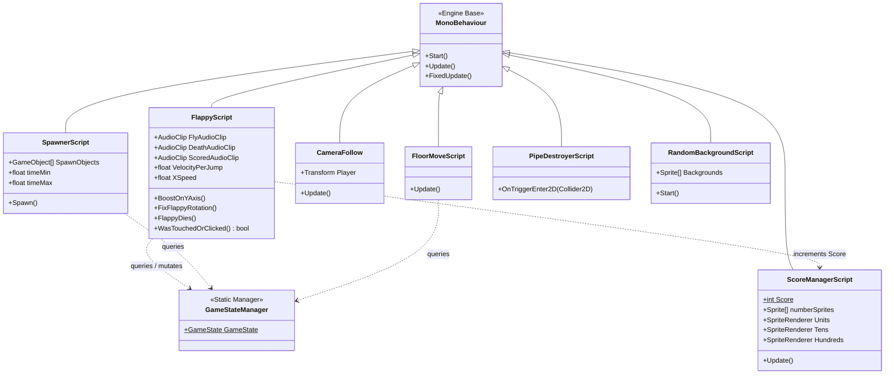
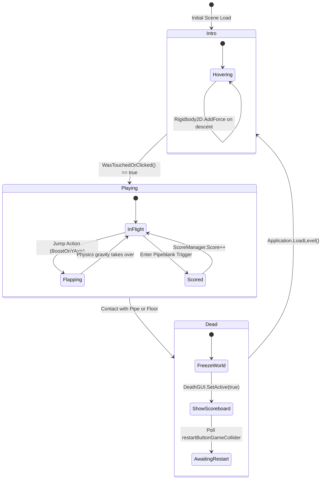

# Game Architecture: Entities, Components & State Machines

---

## 1. Architectural Paradigm: Entity-Component System (ECS)

In Unity, the project adopts the classic **Component-Based Architecture**. Rather than inheriting deep object hierarchies (e.g. `GameObject` &rarr; `MovingEntity` &rarr; `PlayerBird`), functionality is composed through discrete, focused `MonoBehaviour` components attached to GameObjects in the scene graph.

### Component Decomposition
1. **Flappy Bird Player GameObject**:
   - `Transform`: Spatial coordinates (X, Y, Z) and rotation.
   - `SpriteRenderer`: Displays bird animation frame.
   - `Animator`: Drives wing flapping via `flappyAnimation.anim`.
   - `Rigidbody2D`: Box2D physical mass, velocity, gravity scale.
   - `CircleCollider2D`: Tight spherical collision boundary.
   - `AudioSource`: Hardware audio emitter.
   - `FlappyScript`: Custom behavioral driver coordinating input, kinematics, and life cycle.
2. **Pipe Column Prefab GameObject**:
   - `Top Pipe`: `SpriteRenderer` + inverted `BoxCollider2D`.
   - `Bottom Pipe`: `SpriteRenderer` + upright `BoxCollider2D`.
   - `Pipeblank Sensor`: Empty child transform + non-physical `BoxCollider2D` (isTrigger = true) for score detection.
3. **Main Camera GameObject**:
   - `Camera`: Orthographic 2D projection matrix.
   - `CameraFollow`: Script binding X-axis position to player transform.
   - `PipeDestroyer`: Attached boundary trigger cleaning up offscreen obstacles.

---

## 2. Global State Machine

### State Definitions & Global Invariants
- **`GameState.Intro`**: Physics simulation is restricted; procedural pipe spawner is suspended; floor translates smoothly; player bird oscillates gently via buoyant force impulses.
- **`GameState.Playing`**: Full Box2D physics simulation active; obstacle generation running; score trigger sensors active; collision checks enforced.
- **`GameState.Dead`**: Forward motion halted; floor movement frozen; restart button hit testing active; gameplay physics disabled.
