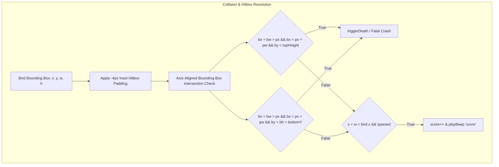

# Core Game Systems: Physics, Collisions & Spawning



---

## 1. Input Subsystem Architecture

The input layer abstracts low-level hardware triggers into discrete game actions:

```csharp
// FlappyScript.cs:98-105
bool WasTouchedOrClicked()
{
    if (Input.GetButtonUp("Jump") || Input.GetMouseButtonDown(0) || 
        (Input.touchCount > 0 && Input.touches[0].phase == TouchPhase.Ended))
        return true;
    else
        return false;
}
```

### Input Normalization Table
| Hardware Source | Underlying API | Engine Event Trigger | Action Dispatched |
| :--- | :--- | :--- | :--- |
| **Keyboard** | Win32 / DirectInput | `Input.GetButtonUp("Jump")` | `BoostOnYAxis()` |
| **Mouse** | Win32 Cursor Event | `Input.GetMouseButtonDown(0)` | `BoostOnYAxis()` |
| **Mobile Glass** | Android / iOS Touch Driver | `Input.touches[0].phase == TouchPhase.Ended` | `BoostOnYAxis()` |
| **Browser DOM** | DOM Level 3 Events | `window.addEventListener('keydown')` | `bird.flap()` |

---

## 2. Collision Detection Systems & Algorithms

### Unity Native: Box2D Solver
In Unity, collisions are resolved by the integrated Box2D physics solver:
- **Bird Collider**: `CircleCollider2D` approximating the bird's round body, eliminating phantom corner catches.
- **Pipe Colliders**: Two `BoxCollider2D` boundaries covering the top and bottom pipes.
- **Score Sensor**: A non-physical `BoxCollider2D` with `isTrigger = true` spanning the open gap between pipes.
- **Continuous Detection**: Uses discrete collision resolution scaled for 50Hz physics ticks.

### Web Canvas Arcade: Forgiving Inset AABB Algorithm
In `play-game.html`, collision is evaluated programmatically on every frame using an **Axis-Aligned Bounding Box (AABB)** test enhanced with an inset margin:

```javascript
// play-game.html:355-370
const bx = bird.x - bird.w / 2 + 4;
const by = bird.y - bird.h / 2 + 4;
const bw = bird.w - 8;
const bh = bird.h - 8;

// Top pipe collision
if (bx + bw > p.x && bx < p.x + p.w && by < p.topHeight) {
  triggerDeath();
}

// Bottom pipe collision
const bottomY = p.topHeight + pipeGap;
if (bx + bw > p.x && bx < p.x + p.w && by + bh > bottomY) {
  triggerDeath();
}
```

> **Design Insight: The Inset Hitbox Padding**: Notice that `bx` and `by` are inset by **+4 pixels**, reducing width and height by **8 pixels**. Pure pixel-perfect bounding boxes feel excessively punishing because players perceive transparent sprite margins as empty air. The 4-pixel forgiveness margin makes close-call flights feel rewarding rather than unfairly lethal.

---

## 3. Procedural Obstacle Spawning Subsystem

Rather than loading static map files, obstacles are generated dynamically:
- **Spawner Coordinates**: Spawner GameObject anchored ahead of the viewport at fixed relative distance.
- **Height Distribution**: Random float offset uniformly distributed across `[-0.5f, 1.0f]` in Unity units (and `[60px, 260px]` in canvas coordinates).
- **Spawn Interval**: Uniformly sampled random delay between `0.7 seconds` and `2.0 seconds`.
- **Power-ups & AI Opponents**: *Not implemented*. The game adheres strictly to classic single-player arcade purity where mechanical precision against static obstacles provides the entire skill ceiling.
