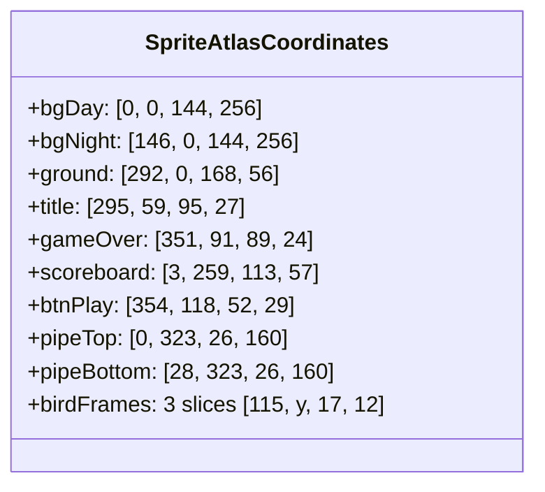

# Rendering Pipeline, Sprites & Visual Presentation

```mermaid
flowchart TD
    subgraph Layer_Stack [Rendering Layer Order (Back to Front)]
        L1[Layer 0: City Skyline Background - Day / Night] --> L2[Layer 1: Procedural Pipe Obstacles - Top & Bottom]
        L2 --> L3[Layer 2: Ground Conveyor Terrain - Repeated Slices]
        L3 --> L4[Layer 3: Player Bird - Rotated Animated Sprite]
        L4 --> L5[Layer 4: UI & HUD Overlays - Digits, Title, Scoreboard]
        L5 --> L6[Layer 5: Collision Flash Overlay - Semi-Transparent White]
    end
```

---

## 1. Graphics Pipeline & Sprite Atlas Architecture

The game utilizes a single master **512x512 Texture Atlas** (`Assets/Sprites/sprites.png`) containing 80 sliced sprites. Using an atlas delivers substantial architectural benefits:
- **Draw Call Reduction**: All background, pipe, ground, bird, and UI elements share the exact same GPU texture buffer, enabling Unity's Dynamic Batcher to collapse rendering into minimal draw calls.
- **Memory Footprint**: Fits entirely within 1MB of VRAM uncompressed (or ~256KB compressed DXT5/ETC2).



---

## 2. 2D Canvas Blitting & Pixel Art Filtering

In `play-game.html`, the canvas renders at a retro native resolution of **288 × 512 pixels**, scaled via CSS to fit modern monitors.

### Crisp Nearest-Neighbor Scaling
To avoid blurry interpolation of pixel art when upscaled, the canvas context explicitly disables smoothing:

```javascript
// play-game.html:119
ctx.imageSmoothingEnabled = false;
```
Combined with CSS properties:
```css
image-rendering: -moz-crisp-edges;
image-rendering: -webkit-crisp-edges;
image-rendering: pixelated;
image-rendering: crisp-edges;
```

---

## 3. Visual Effects: The Collision Impact Flash

To deliver arcade impact feedback when the bird crashes, the renderer overlays a dynamic white flash:

```javascript
// play-game.html:507-510
if (flashAlpha > 0) {
  ctx.fillStyle = `rgba(255, 255, 255, ${flashAlpha})`;
  ctx.fillRect(0, 0, canvas.width, canvas.height);
}
```
Upon collision, `flashAlpha` is set to `0.8`, decaying by `0.05` per frame. This 16-frame visual pulse communicates physical impact before the scoreboard displays.
