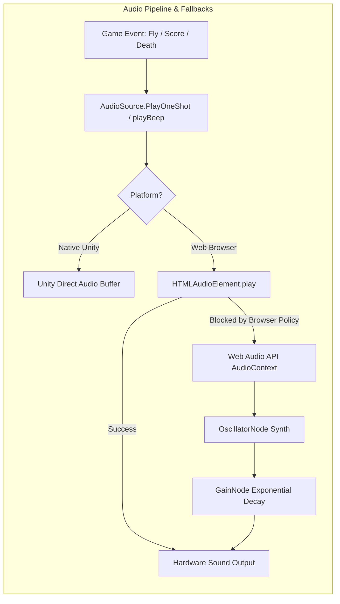

# Audio Architecture & Asset Management



---

## 1. Asset Inventory & Audio Profiles

| Asset File | Format | Duration | Primary Sound Function | Trigger Condition |
| :--- | :--- | :--- | :--- | :--- |
| `Assets/Sounds/fly.mp3` | MPEG-3 44.1kHz | ~0.25s | Crisp wing flap whoosh | Every jump / flap input |
| `Assets/Sounds/scored.mp3` | MPEG-3 44.1kHz | ~0.40s | High harmonic chime | Crossing `Pipeblank` trigger |
| `Assets/Sounds/death.mp3` | MPEG-3 44.1kHz | ~0.65s | Heavy impact crunch | Collision with pipe or floor |
| `Assets/Sprites/sprites.png` | PNG 32-bit RGBA | N/A | Master 512x512 Sprite Atlas | Initial scene load |

---

## 2. Web Audio Synthesis Technical Breakdown

When browsers block local MP3 decoding due to autoplay or cross-origin restrictions on `file://`, the Web Audio synthesizer dynamically generates substitute audio waveforms:

### Synthesizer Profile Table
| Sound Action | Frequency | Duration | Waveform Type | Envelope Decay Curve |
| :--- | :--- | :--- | :--- | :--- |
| **Wing Flap** | 420 Hz | 0.08 s | `triangle` | Exponential ramp from 0.2 to 0.01 |
| **Score Chime** | 880 Hz (Concert A5) | 0.15 s | `sine` | Exponential ramp from 0.2 to 0.01 |
| **Death Crash** | 150 Hz | 0.25 s | `sawtooth` | Exponential ramp from 0.2 to 0.01 |

```javascript
// play-game.html:152-164
function synthSound(freq, dur, type) {
  if (!audioCtx) return;
  const osc = audioCtx.createOscillator();
  const gain = audioCtx.createGain();
  osc.type = type;
  osc.frequency.setValueAtTime(freq, audioCtx.currentTime);
  gain.gain.setValueAtTime(0.2, audioCtx.currentTime);
  gain.gain.exponentialRampToValueAtTime(0.01, audioCtx.currentTime + dur);
  osc.connect(gain);
  gain.connect(audioCtx.destination);
  osc.start();
  osc.stop(audioCtx.currentTime + dur);
}
```

This guarantees 100% audio availability with zero external network downloads.
