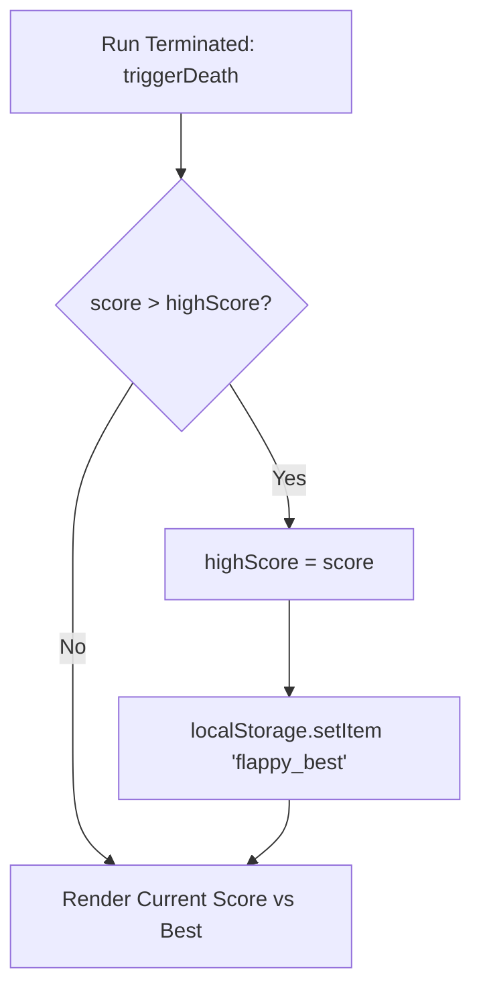

# Data Persistence & Session State



---

## 1. Storage Paradigm & Architecture

| Tier | Native Unity | Web Browser Arcade |
| :--- | :--- | :--- |
| **Active Run Score** | In-memory static field: `ScoreManagerScript.Score` | In-memory variable: `let score = 0;` |
| **All-Time High Score** | Ephemeral scene memory (resets on full app close) | Persistent client storage: `localStorage.getItem('flappy_best')` |
| **Remote Leaderboard** | *Not implemented* (Client-side standalone) | *Not implemented* (Client-side standalone) |
| **User Authentication** | *Not implemented* | *Not implemented* |

---

## 2. Web LocalStorage Implementation

In `play-game.html`, persistence uses the W3C Web Storage API:

1. **Initialization (`play-game.html:190`)**:
   ```javascript
   let highScore = parseInt(localStorage.getItem('flappy_best') || '0', 10);
   ```
2. **Commit on New Record (`play-game.html:279-282`)**:
   ```javascript
   if (score > highScore) {
     highScore = score;
     localStorage.setItem('flappy_best', highScore);
   }
   ```
3. **Robustness & Fallback**:
   If localStorage is blocked by private browsing mode or enterprise security sandboxes, `parseInt` safely falls back to `'0'`, preventing runtime script crashes.
